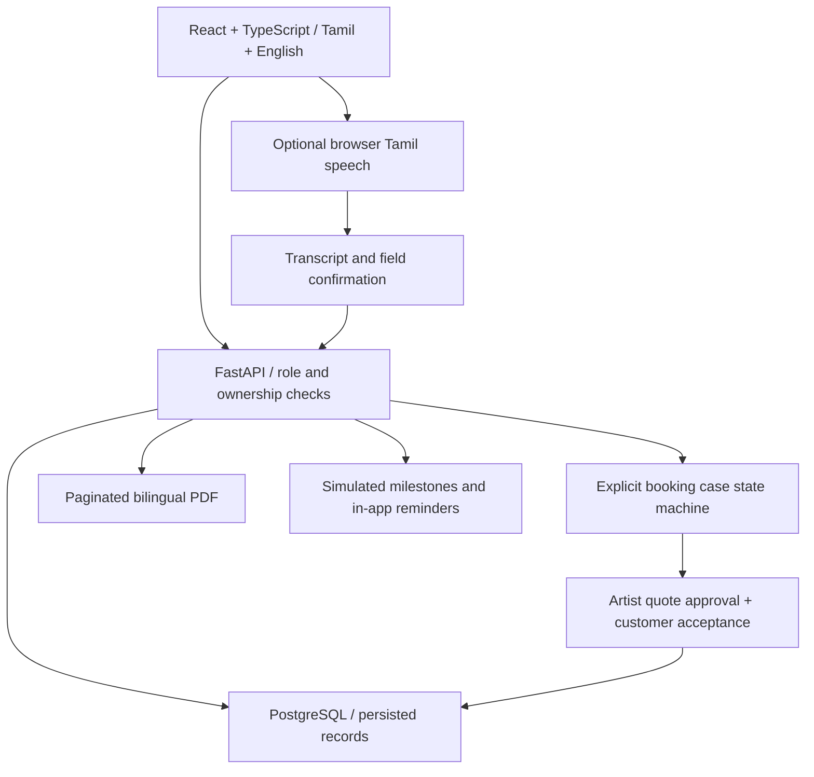
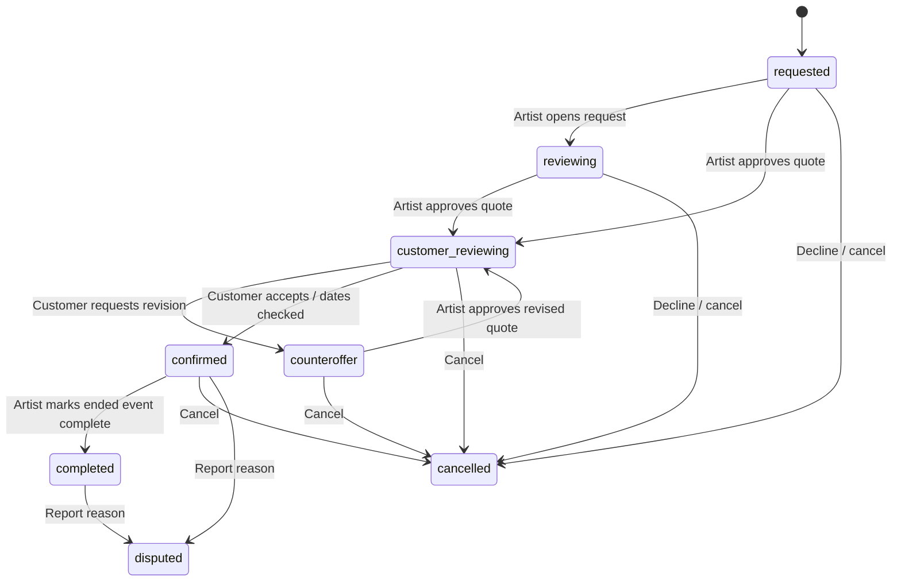

# Architecture

The same SQLAlchemy persistence layer supports an explicit SQLite local demo.
No external LLM is required. `/plan` persists matching and constraint results and a draft quote, never approvals or reservations. Declines persist alternatives. Selection always starts a new customer request.

Confirmation locks the artist database row on PostgreSQL, rechecks collisions, writes approval and both simulated milestones in one transaction. A process lock also serializes SQLite local writes. Audit and notification records are committed with the booking. SQLite is for a single local API process; use PostgreSQL for multiple workers.

Records store JSON documents as TEXT to keep the first migration small and portable. This trades query efficiency for a straightforward demo. Add relational constraints, indexed time ranges and a PostgreSQL exclusion constraint before scaling. API users never receive database credentials; Supabase REST access must stay disabled for these private tables.
